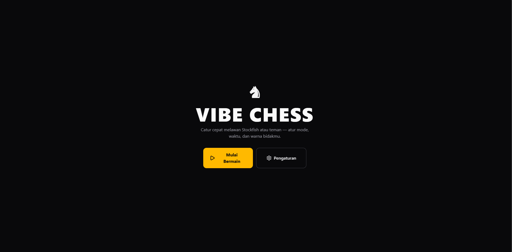
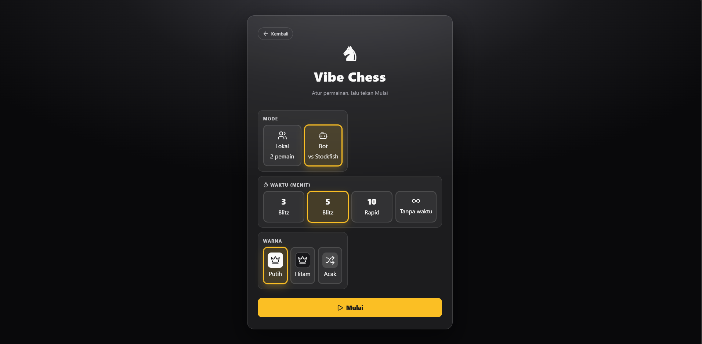
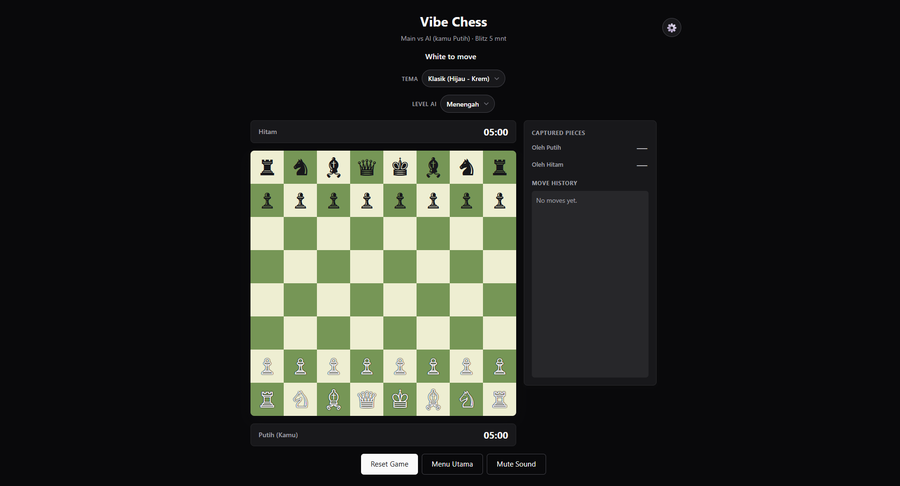

<div align="center">
  
  
  <h3 align="center">Vibe Chess</h3>

  <p align="center">
    A modern, elegant, and feature-rich web-based chess application.
    <br />
    <a href="#features"><strong>Explore the docs »</strong></a>
    <br />
    <br />
    <a href="#">View Demo</a>
    ·
    <a href="https://github.com/yourusername/chess-vibe/issues">Report Bug</a>
    ·
    <a href="https://github.com/yourusername/chess-vibe/issues">Request Feature</a>
  </p>
</div>

<!-- BADGES -->
<div align="center">
  
  
  
  
</div>

<details>
  <summary>Table of Contents</summary>
  <ol>
    <li>
      <a href="#about-the-project">About The Project</a>
      <ul>
        <li><a href="#built-with">Built With</a></li>
      </ul>
    </li>
    <li>
      <a href="#features">Features</a>
    </li>
    <li>
      <a href="#getting-started">Getting Started</a>
      <ul>
        <li><a href="#prerequisites">Prerequisites</a></li>
        <li><a href="#installation">Installation</a></li>
      </ul>
    </li>
    <li><a href="#project-structure">Project Structure</a></li>
    <li><a href="#roadmap">Roadmap</a></li>
    <li><a href="#contributing">Contributing</a></li>
    <li><a href="#license">License</a></li>
  </ol>
</details>

## About The Project

<!-- SCREENSHOT PLACEHOLDER -->
<p align="center">
  
  
  
</p>

Vibe Chess is not just another chess clone. It is a thoughtfully designed, immersive web chess experience built from the ground up to provide both casual and competitive players with a beautiful environment to play, practice, and focus.

Whether you are analyzing deep lines against the integrated Stockfish engine or playing a quick blitz match with a friend locally, Vibe Chess delivers a smooth, responsive, and distraction-free interface.

### Built With

- [![React][React.js]][React-url]
- [![Vite][Vite.js]][Vite-url]
- [![Tailwind][Tailwind.js]][Tailwind-url]
- **Chess.js** (Move validation & logic)
- **Stockfish.js** (Advanced AI Engine)

## Features

- ♟️ **Versatile Game Modes**
    - **Local PvP:** Play face-to-face on the same screen.
    - **Player vs Engine:** Test your mettle against Stockfish with variable difficulty and human-like artificial move delays.
- ⏱️ **Precision Time Controls**
    - Support for Bullet, Blitz, Rapid, and Classical time formats, plus an Unlimited mode for deep analysis.
- 🎨 **Immersive UI/UX**
    - **Dynamic Theming:** Seamless Dark and Light mode transitions (persisted via LocalStorage).
    - **Focus Mode BGM:** Built-in Lo-Fi/ambient background music toggle.
    - **Modern Navigation:** Smooth transitions from Landing to Setup, straight into the Action.
- ⚙️ **Quality of Life**
    - Dynamic board flipping based on selected color (White/Black/Random).
    - Legal move highlights and last-move indicators.

## Getting Started

To get a local copy up and running, follow these simple steps.

### Prerequisites

Ensure you have the latest LTS version of Node.js and npm installed.

- npm
    ```sh
    npm install npm@latest -g
    ```

### Installation

1. Clone the repo
    ```sh
    git clone https://github.com/yourusername/chess-vibe.git
    ```
2. Navigate into the directory
    ```sh
    cd chess-vibe
    ```
3. Install NPM packages
    ```sh
    npm install
    ```
4. Start the development server
    ```sh
    npm run dev
    ```

## Project Structure

A quick overview of the core application structure:

```text
chess-vibe/
├── public/                 # Static assets (favicons, Stockfish web workers)
├── src/
│   ├── components/         # Reusable React UI components
│   │   ├── Board.jsx       # Main chessboard rendering & logic
│   │   ├── MainMenu.jsx    # Game configuration screen
│   │   ├── Timer.jsx       # Chess clock logic
│   │   └── ...
│   ├── App.jsx             # Main application flow & state management
│   ├── index.css           # Global styles & Tailwind directives
│   └── game.js             # Chess state encapsulation
├── package.json
└── vite.config.js
```

## Roadmap

- [x] Integrate Stockfish Engine
- [x] Implement Time Controls
- [x] Add Dark/Light Mode & BGM
- [ ] Add Online Multiplayer (WebSockets)
- [ ] Implement Post-Match Analytics & Accuracy Score
- [ ] Add Move History (PGN Export)

## Contributing

Contributions are what make the open source community such an amazing place to learn, inspire, and create. Any contributions you make are **greatly appreciated**.

If you have a suggestion that would make this better, please fork the repo and create a pull request. You can also simply open an issue with the tag "enhancement".

1. Fork the Project
2. Create your Feature Branch (`git checkout -b feature/AmazingFeature`)
3. Commit your Changes (`git commit -m 'Add some AmazingFeature'`)
4. Push to the Branch (`git push origin feature/AmazingFeature`)
5. Open a Pull Request

<!-- MARKDOWN LINKS & IMAGES -->

[product-screenshot]: https://via.placeholder.com/1000x500.png?text=Vibe+Chess+Screenshot+Here
[React.js]: https://img.shields.io/badge/React-20232A?style=for-the-badge&logo=react&logoColor=61DAFB
[React-url]: https://reactjs.org/
[Vite.js]: https://img.shields.io/badge/Vite-646CFF?style=for-the-badge&logo=vite&logoColor=white
[Vite-url]: https://vitejs.dev/
[Tailwind.js]: https://img.shields.io/badge/Tailwind_CSS-38B2AC?style=for-the-badge&logo=tailwind-css&logoColor=white
[Tailwind-url]: https://tailwindcss.com/
